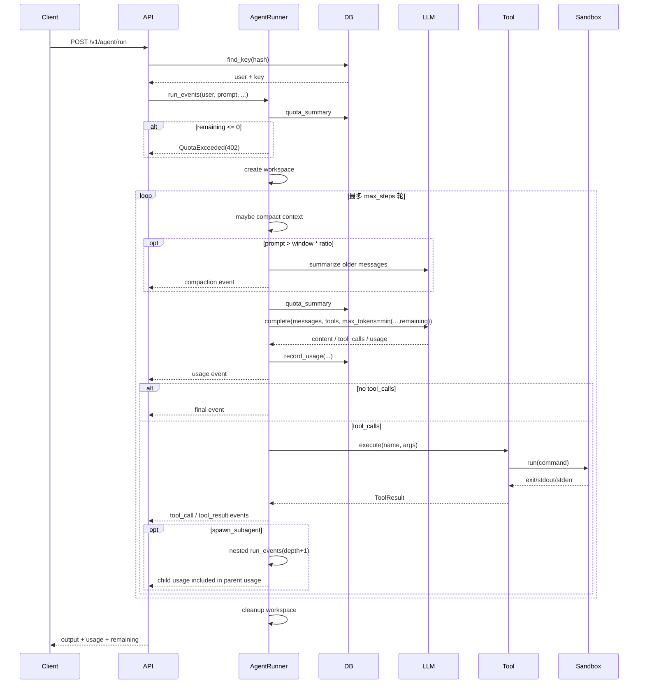

# mini-harness 设计说明

## 1. 目标与非目标

### 目标

1. **可复用**：其他项目不需要重复实现 agent loop、工具执行、沙箱和额度控制。
2. **简单**：单进程 + SQLite + 标准库沙箱即可跑起来；依赖只有 FastAPI / httpx / Pydantic。
3. **可隔离**：同一套工具接口支持本地子进程与 Docker 两种执行后端。
4. **可计量**：每个用户、每个 API Key、每次 run 的 token 消耗可追踪、可限额、可重置。
5. **可嵌入**：HTTP JSON + SSE + 单文件 SDK；调用方可以用任何语言。
6. **可长跑**：自动压缩上下文、可关闭运行时限，并允许主代理派生子代理。
7. **多模态**：接受图片输入（base64 / URL），透传给支持 Vision 的模型。
8. **多模型**：一个实例可挂载多个模型，按请求选择，支持直连 provider 与 OpenCode Zen。

### 非目标

- 不是通用工作流引擎（没有 DAG、定时任务、人工审批节点）。
- 不是多租户 SaaS 计费系统（没有组织、账单、支付、模型单价）。
- 不是强安全的多租户隔离平台（`local` 后端明确不是安全边界）。
- 不做会话持久化（`history` 由调用方传入）。
- 不做 token 级流式转发（当前是事件级 SSE）。

---

## 2. 组件

```text
┌─────────────────────────────────────────────────────────────┐
│                        FastAPI (app.py)                      │
│  /v1/me  /v1/usage  /v1/agent/run  /v1/agent/stream          │
│  /admin/*  (X-Admin-Token)          /admin/ui                │
└───────────────┬───────────────────────────────┬──────────────┘
                │                               │
        ┌───────▼────────┐              ┌───────▼────────┐
        │  AgentRunner   │              │   Database     │
        │  agent.py      │─────────────▶│   db.py        │
        │                │  usage event │  users/keys/   │
        └───┬────────┬───┘              │  usage_events  │
            │        │                  └────────────────┘
   ┌────────▼──┐  ┌──▼─────────────┐
   │ LLMClient │  │  ToolRegistry  │
   │ llm.py    │  │  tools/        │
   └────────┬──┘  └──┬─────────────┘
            │        │
   ┌────────▼──┐  ┌──▼──────────────────────────┐
   │ Provider  │  │ Sandbox (local | docker)    │
   │ OpenAI-   │  │ 超时 / 资源 / 目录 / 输出上限 │
   │ compat    │  └─────────────────────────────┘
   └───────────┘
```

### 职责边界

| 组件 | 负责 | 不负责 |
| --- | --- | --- |
| `api/` | 鉴权、参数校验、HTTP/SSE 映射 | 业务逻辑、模型调用 |
| `AgentRunner` | 多步循环、工具调度、额度检查、上下文压缩、子代理、事件生成 | 持久化会话 |
| `ModelCatalog` / `ModelRouter` | alias 解析、模型元数据、按模型创建客户端并路由 | 非 chat-completions 协议适配 |
| `LLMClient` | provider 协议、重试、usage 归一化 | 工具执行 |
| `ToolRegistry` | 工具 schema、参数解析、错误隔离 | 进程隔离 |
| `Sandbox` | 执行命令、资源限制、输出截断 | 工具语义、路径校验 |
| `Database` | 用户、Key、用量账本、额度汇总 | 并发调度 |
| `WorkspaceManager` | 每次 run 的目录生命周期 | 文件内容策略 |

---

## 3. 请求生命周期



### 关键决策

1. **事件流是唯一执行原语**。`run_events()` 是 async generator，同步接口收集 `final`，
   SSE 接口逐条转发。避免同步/流式两套循环逻辑漂移。
2. **工具错误不终止 run**。`ToolRegistry.execute()` 把异常转换为 `ToolResult(is_error=True)`，
   模型看到 `ERROR: ...` 后可以自我修正；只有额度、超时、LLM 故障会终止。
3. **额度在每次模型调用后立即落账**。即使后续步骤失败，已经消耗的 token 也不会丢。
4. **workspace 在 `finally` 中清理**。客户端断连取消生成器时同样会清理。

### 实时运行视图

- `OpenAICompatLLM` 在 `on_delta` 存在时使用 `stream: true`，解析 content / reasoning /
  tool_call 增量，并在结束时归一化为原来的 `LLMResponse`。
- `AgentRunner` 通过回调把增量写入进程内 `LiveRunRegistry`；不改变非流式调用方的接口。
- 快照包含 `status / current_step / content / reasoning / steps / output / elapsed_ms`。
- 管理端 `/admin/runs/live`、`/admin/runs/{run_id}/live` 可跨用户查看；
  用户端 `/v1/runs/live`、`/v1/runs/{run_id}/live` 只能看自己的 run。
- `/admin/runs/{run_id}/live/stream` 用 SSE 推送 `content_delta / reasoning_delta / steps`，
  前端只更新对应文本节点；滚动位置保持，只有原本在底部时才自动跟随。
- live 数据是内存态，完成后保留 1 小时；模型调用结束后的完整正文仍写入 `call_logs`（7 天）。
- 需要不中断旧任务地发布新版本时，可启动第二个实例共享同一 SQLite/workspace（blue/green），
  旧进程继续跑完，新进程提供实时视图；旧进程的当前调用无法追溯 token 级增量。

---

## 4. 数据模型

```sql
users(
  id TEXT PK, email TEXT UNIQUE, name TEXT, status TEXT,
  quota_tokens INTEGER,          -- -1 = unlimited
  quota_period_start TEXT,       -- 本期用量起点（重置水位）
  created_at TEXT, updated_at TEXT
)

api_keys(
  id TEXT PK, user_id TEXT FK, key_hash TEXT UNIQUE,
  prefix TEXT, name TEXT, created_at TEXT,
  last_used_at TEXT, revoked_at TEXT
)

usage_events(                     -- append-only 账本（长期保留）
  id INTEGER PK AUTOINCREMENT,
  user_id TEXT FK, api_key_id TEXT,
  run_id TEXT, model TEXT,
  prompt_tokens INTEGER, completion_tokens INTEGER, total_tokens INTEGER,
  created_at TEXT
)

call_logs(                        -- prompt / 回复正文（默认保留 7 天）
  id INTEGER PK AUTOINCREMENT,
  usage_event_id INTEGER UNIQUE FK,
  user_id TEXT, api_key_id TEXT, run_id TEXT,
  request_json TEXT,              -- 完整 messages
  response_text TEXT,             -- 模型回复正文
  tool_calls_json TEXT, reasoning_text TEXT,
  truncated INTEGER, created_at TEXT
)
```

设计取舍：

- **不删除流水**。重置只移动 `quota_period_start`，保留审计与排障能力。
- **已用额度用 SUM 计算**，不做冗余计数器，避免重置/失败时不一致。
- **时间统一 UTC ISO-8601（微秒）**，字符串比较即可用于水位筛选。
- **Key 只存 SHA-256**。Key 本身是 256-bit 随机串，不需要慢哈希；SHA-256 足以防止库泄露后直接复用。
- **调用正文与额度账本分离**。`usage_events` 长期保留用于额度；`call_logs` 存
  prompt / 回复 / tool_calls / reasoning，默认 7 天后由后台任务清理。这样删除正文
  不会改变已用额度或导致历史配额统计失真。
- **`/admin/usage` 只返回元数据**，正文通过 `/admin/usage/{event_id}/body` 按需读取，
  避免列表接口一次返回数百 MB。`CALL_LOG_ENABLED=false` 可关闭正文存储；
  `CALL_LOG_MAX_CHARS` 可限制单字段大小。
- **SQLite + WAL**，单机足够；`Database` 内用 `RLock` 串行化写操作。

---

## 5. 额度算法

```text
remaining(user) = quota < 0 ? ∞ : max(0, quota - sum(events since period_start))

before_each_llm_call:
    if remaining <= 0: raise 402
    call_max_tokens = min(requested_max_tokens, remaining)

after_each_llm_call:
    insert usage_event(actual usage)
    if no tool_calls:
        return final answer          # 允许最后一次自然超额
    if remaining <= 0:
        raise 402                    # 否则不再继续消耗
```

### 边界与已知问题

| 场景 | 行为 |
| --- | --- |
| 单次调用超额度 | completion 被 `max_tokens` 钳制；prompt 仍可能推高实际用量 |
| 最终答案恰好耗尽 | 正常返回，`remaining_tokens=0`，`used` 可能略大于 quota |
| 并发 run | 各自预检查通过，最坏每个并发 run 超额一次调用 |
| 运行中重置额度 | 重置水位之后的用量会重新计入；运维上建议避免与长任务并发 |
| provider 不返回 usage | 用 CJK 感知的字符估算兜底，避免额度被绕过 |
| provider 返回错误 | 不记账；已完成的调用已记账 |
| 客户端断连 | 生成器取消；已完成调用已记账，workspace 清理 |

### 严格硬上限的扩展

增加 `reserved_tokens` 列与事务：

1. 请求开始时原子地预留 `min(quota - used - reserved, run_budget)`；
2. 每次记账从预留中扣减；
3. run 结束时释放未使用预留。

代价是需要处理超时/进程崩溃后的预留回收，复杂度明显上升；当前版本刻意不做。

---

## 6. 沙箱与威胁模型

### local

- 在子进程中执行：`setsid` + `RLIMIT_CPU` / `RLIMIT_AS` / `RLIMIT_FSIZE` / `RLIMIT_CORE`。
- wall-clock 超时后 `SIGKILL` 整个进程组。
- 环境变量白名单：只传 `PATH/HOME/TMPDIR/LANG/...`，不继承宿主敏感变量。
- workspace 限制：`cwd` 必须位于 workspace root 内。
- **威胁模型：不防恶意代码**。同一 OS 用户，可读宿主文件、可访问网络。

### docker

- 每次工具调用一个一次性容器，`--rm`。
- `--network none`（可配置为 `bridge`）。
- `--read-only` + 只读根文件系统，`/tmp` 为 tmpfs。
- `--cap-drop ALL`、`no-new-privileges`。
- `--memory` / `--memory-swap` / `--cpus` / `--pids-limit`。
- workspace 以 `rw` 挂载到 `/workspace`，并以宿主 uid/gid 运行，避免 root 拥有产物。
- **仍需注意**：镜像本身的供应链安全；workspace 内可以写文件；容器逃逸漏洞不在本设计防护范围内。

### 文件工具

`read_file` / `write_file` / `list_dir` 在宿主侧执行，但：

- 拒绝绝对路径；
- `resolve()` 后必须仍在 run workspace 内；
- 写入前创建父目录后再次校验；
- 读取/写入有字节上限。

由于 Docker 后端把同一 workspace 挂载进容器，文件工具在两种后端下语义一致。

---

## 7. 上下文压缩、子代理与多模态

### 自动上下文压缩

触发条件：每次模型调用前，`estimate_messages_tokens(messages) >=
AGENT_CONTEXT_WINDOW_TOKENS × AGENT_CONTEXT_COMPRESS_RATIO`。

压缩步骤：

1. 保留 system message 与**最近一轮** assistant tool_calls + tool results；
   这样压缩后的历史不会以孤立的 tool message 开头。
2. 更早的消息格式化为 transcript，按 `AGENT_CONTEXT_COMPRESS_INPUT_TOKENS`
   截断（保留头尾）。
3. 调用模型生成摘要，`max_tokens = AGENT_CONTEXT_SUMMARY_MAX_TOKENS`，并受剩余额度钳制。
4. 用一条 `[Compressed context from earlier in this run]` 用户消息替换旧消息。

性质：

- 摘要调用本身是一条普通 LLM 调用：立即记账、计入 run usage，并产生 `compaction` 事件。
- 摘要失败或额度不足时退化为确定性截断，不中断 run。
- token 估算基于字符（CJK 感知），是保守近似；窗口应设置得略低于真实 context length。
- 避免对“只有一条摘要”的历史重复压缩；否则会形成无意义的压缩循环。

### 子代理

工具 `spawn_subagent` 在 `AgentRunner` 内部启动嵌套 `run_events(depth + 1)`：

- **共享 workspace**：子代理可以读写父代理创建的文件，不额外创建目录。
- **共享额度**：子代理的每次模型调用独立写入 `usage_events`（run_id 为 `sub_...`），
  同时其最终 usage 会并入父 run 的 usage 统计。
- **深度限制**：`AGENT_MAX_SUBAGENT_DEPTH`（默认 2，0 禁用）；达到上限后工具返回错误，
  模型应直接完成任务。
- **顺序执行**：当前实现一次工具调用只派生一个子代理，不并行 fan-out；避免 workspace 写冲突。
- **递归成本**：子代理拥有相同工具集，包括 `spawn_subagent`；深度和额度共同限制爆炸半径。

### 多模态输入

`RunRequest.images` 被转换为 OpenAI 兼容的 user content blocks：

```json
[
  {"type": "text", "text": "这张图是什么？"},
  {"type": "image_url", "image_url": {"url": "data:image/png;base64,...", "detail": "auto"}}
]
```

- 支持 base64 data URL 与公网 `http(s)` URL；图片只允许出现在 user 消息。
- `history` 同样接受 OpenAI 风格 content blocks，便于携带多轮图片上下文。
- 模型需要支持 Vision；DeepSeek 使用 `deepseek-flash`，`deepseek-v4-pro` 不支持图片。
- 单请求最多 10 张（harness 限制）；DeepSeek 侧单图最大 32 MiB、请求体 48 MiB。
- fallback token 估算按每张图片 1024 tokens（DeepSeek 的单图上限）；实际以 provider usage 为准。
- `call_logs.request_json` 会保存图片 block；受 7 天正文保留策略约束。
- 压缩 transcript 只写入 `[image: ...]` 占位符，避免把 base64 塞进摘要 prompt。

### 运行时限

`AGENT_RUN_TIMEOUT_SECONDS=0` 与 `LLM_TIMEOUT_SECONDS=0` 表示不设超时。
`_check_deadline()` 在 limit <= 0 时直接返回；httpx 在 timeout <= 0 时使用 `timeout=None`。
关掉超时适合长任务，但生产环境应在网关/取消机制上补保护。

---

## 8. 模型目录与多模型路由

### ModelSpec

每个模型由 `ModelSpec` 描述：

```text
alias / provider / model_id / base_url / api_key
context_window / max_output_tokens
supports_tools / supports_vision
thinking: enabled | disabled | omit | None(继承全局)
```

`/v1/models` 只暴露 alias 与能力/限额，不暴露 API Key。

### 目录来源

- **直连**：`LLM_BASE_URL / LLM_API_KEY / LLM_MODEL`，alias 使用 `LLM_MODEL`。
- **OpenCode Zen**：`OPENCODE_ZEN_API_KEY` + `OPENCODE_ZEN_MODELS`（逗号分隔），
  base URL 为 `https://opencode.ai/inference/openai/v1`。
- `LLM_DEFAULT_MODEL` 决定默认 alias；为空时用 `LLM_MODEL`，再退化为目录第一项。
- 已知 Zen 模型有 `ZEN_PRESETS` 元数据；未知模型用保守默认（128K 上下文 / 32K 输出 /
  无 Vision / 省略 thinking）。

### 路由

`ModelRouter` 按 alias 懒加载 `OpenAICompatLLM`：

1. clone 全局 Settings，替换 `base_url / api_key / model`；
2. 按 spec 的 thinking 策略创建客户端（GLM thinking-only 时省略 thinking 字段）；
3. 请求体使用 provider 的真实 `model_id`，不是 alias；
4. `close()` 统一关闭所有 provider 客户端。

### 请求绑定

- `RunRequest.model` 选择 alias；未知 alias 返回 `400 model_not_found`。
- `AgentRunner` 用所选 spec 的 `context_window` 决定压缩阈值，
  用 `max_output_tokens` 再钳制 `max_tokens`。
- `spawn_subagent` 支持 `model` 参数，父/子代理可使用不同模型；
  子代理 usage 仍然并入父 run 统计。
- `usage_events.model` 记录 provider 返回的实际模型名，调用历史可直接看到。

### 边界

当前接入的是 OpenCode Zen 的 **OpenAI-compatible chat completions** 模型。
Zen 上的 GPT/Claude/Gemini 使用 Responses / Anthropic / Google 协议，需要额外协议适配器；
未实测的模型 ID 不默认启用。

---

## 9. 可扩展点

| 需求 | 扩展方式 |
| --- | --- |
| 新工具 | 继承 `tools.base.Tool`，实现 `execute()`，注册到 `build_default_registry()` |
| 新沙箱 | 实现 `sandbox.base.Sandbox` 协议，在 `sandbox/factory.py` 增加分支 |
| 新模型协议 | 实现 `llm.LLMClient` 协议（`complete` / `close`） |
| 工具级权限 | 在 `ToolRegistry.execute()` 或 `ToolContext` 中加入角色/白名单 |
| 严格额度 | 增加 reservation 表 + 原子扣减（见 §5） |
| 压缩策略 | 修改 `AgentRunner._maybe_compress()` 的切分/摘要策略，或换用外部摘要服务 |
| 子代理并行 | 在 `spawn_subagent` 基础上增加批量工具与独立子 workspace |
| 多机部署 | 用 Postgres 替换 `Database`；workspace 换共享卷/对象存储；Redis 做限额原子操作 |
| 计费金额 | 增加 `model_prices` 表，在 `record_usage` 时折算 cost |
| 观测性 | 在 `AgentRunner` 事件流上接 OpenTelemetry spans；usage 事件导出 metrics |
| 会话持久化 | 新增 `runs` / `messages` 表，`/v1/agent/run` 接受 `conversation_id` |

保持接口稳定的关键：**事件字典的 `type` 字段**与**工具 schema 的 OpenAI 格式**。
新增字段是向后兼容的；不要重命名已有字段。

---

## 10. 故障与错误码

| HTTP | code | 场景 |
| --- | --- | --- |
| 400 | `bad_request` / `tool_error` / `model_not_found` | 参数非法、工具参数非法、未知模型 alias |
| 401 | `unauthorized` | 缺失/无效/吊销的 API Key，或 admin token 错误 |
| 402 | `quota_exceeded` | 额度耗尽 |
| 403 | `forbidden` | 用户被禁用 |
| 404 | `not_found` | 用户/Key 不存在 |
| 409 | `conflict` | 邮箱重复 |
| 422 | FastAPI 默认 | Pydantic 参数校验失败 |
| 500 | `agent_failed` / `sandbox_error` | 内部错误 |
| 502 | `llm_error` | provider 4xx/5xx、网络失败、响应不可解析 |
| 503 | `llm_not_configured` | 未配置 `LLM_API_KEY` |
| 504 | `run_timeout` | 整体 run 超时 |

SSE 一旦开始，HTTP 状态码已固定为 200；后续错误以 `{"type":"error"}` 事件发送。

---

## 11. 生产化清单

- [ ] 设置强随机 `HARNESS_ADMIN_TOKEN`，限制 `/admin/*` 来源
- [ ] TLS 终止、CORS 白名单、请求体大小限制
- [ ] 使用 `docker` 沙箱处理不可信代码；固定镜像 digest
- [ ] 将 SQLite 放到持久卷，或迁移到 Postgres
- [ ] 日志脱敏（不要记录 API Key、admin token、prompt 全文）
- [ ] 监控：额度耗尽率、LLM 错误率、工具超时率、run 时延、compaction 频率
- [ ] 将 `AGENT_CONTEXT_WINDOW_TOKENS` 设为略低于 provider 真实窗口，并观察摘要质量
- [ ] 不限运行时间时，在反向代理/网关层增加超时与取消策略
- [ ] 限制 `AGENT_MAX_SUBAGENT_DEPTH`，并监控 `sub_` run 的 token 消耗
- [ ] 管理 `OPENCODE_ZEN_API_KEY` / provider Key，按模型确认账号权限与预算
- [ ] 用 `/v1/models` 核对各模型的上下文/输出上限，按需覆盖保守默认值
- [ ] 备份 `usage_events`（计费/审计依据）
- [ ] 多 worker 时统一 admin token；SQLite 写并发高时迁移数据库
