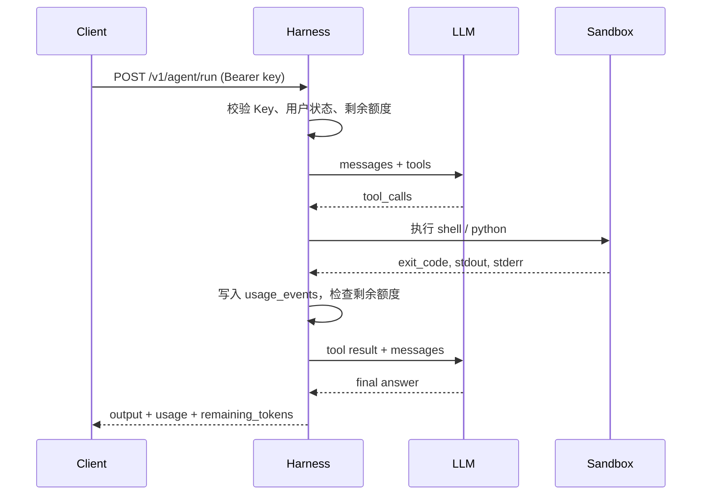

# mini-harness

一个**小而完整**的 LLM agent harness：把「模型 + 工具 + 沙箱 + 用户额度」封装成一个独立服务。
其他项目不需要自己实现 agent 循环，只要通过 HTTP / Python SDK 调用即可。

- **Agent 循环**：多步工具调用、最大步数、可配置运行时限（0 = 不限）、失败自适应
- **数学计算**：`run_python` 预装 SymPy 1.14（符号化简、积分、方程求解等）
- **多模型**：同一服务内置模型目录，按请求选择 DeepSeek / GLM / MiniMax；OpenCode Zen 与直连后端可并存
- **多模态**：图片输入（base64 data URL / 公网 URL），兼容 DeepSeek Vision；调用历史可回看图片
- **自动上下文压缩**：接近模型上下文窗口时自动总结旧消息，保留最近工具轮次
- **子代理**：主代理可调用 `spawn_subagent` 委派子任务，共享 workspace 与额度，限制嵌套深度
- **实时进度**：运行中的请求可查看已生成正文与推理内容；管理台“运行中”与 API 均支持
- **可插拔沙箱**：本地子进程（rlimit/超时/环境隔离）或 Docker（无网络、只读根文件系统、资源上限）
- **用户管理系统**：用户、API Key、按 **tokens** 计量的额度、用量流水、重置、启停用
- **管理控制台**：`/admin/ui`，用户/额度/Key/调用历史（可查看 prompt 与回复正文），单文件、无构建步骤、无 CDN 依赖
- **协议无关**：任意 OpenAI-compatible `chat/completions`（DeepSeek / OpenAI / vLLM / Ollama / LiteLLM）
- **易于嵌入**：同步 JSON、SSE 流式、Python SDK，其他语言直接走 HTTP

> 适合内部工具、多人共用一把模型 Key、需要给不同用户/项目分配 token 预算的场景。

用户由管理员在控制台或管理 API 创建并签发 Key，不开放自助注册；额度周期由管理员手动重置
（需要按月重置时，可由外部定时任务调用 reset 接口）。

---

## 架构

```mermaid
flowchart LR
    subgraph Callers[调用方]
        A[业务项目 / 脚本]
        U[管理员浏览器]
    end

    subgraph H[mini-harness]
        API[FastAPI<br/>鉴权 / 限流入口]
        AG[Agent Loop]
        TR[Tool Registry]
        SB[Sandbox<br/>local | docker]
        DB[(SQLite<br/>users / keys / usage)]
        UI[Admin UI]
    end

    LLM[(OpenAI-compatible LLM)]

    A -->|Bearer hx_...| API
    U -->|X-Admin-Token| UI
    UI --> API
    API --> AG
    AG -->|chat/completions + tools| LLM
    AG --> TR
    TR --> SB
    AG -->|每次模型调用记账| DB
    API --> DB
```

一次 agent 请求：



---

## 快速开始

```bash
cd miniharness

python3 -m venv .venv
.venv/bin/pip install -e ".[dev]"

cp .env.example .env
# 编辑 .env：至少填入 LLM_API_KEY；生产环境务必设置 HARNESS_ADMIN_TOKEN

.venv/bin/python -m harness
```

打开：

- 控制台：<http://127.0.0.1:8000/admin/ui>
- OpenAPI：<http://127.0.0.1:8000/docs>
- 健康检查：<http://127.0.0.1:8000/healthz>

> 未设置 `HARNESS_ADMIN_TOKEN` 时，服务会随机生成一个并打印到日志（仅适合本地开发）。
> 多 worker / 生产部署必须显式设置，否则每个进程的 token 不同。

### 创建第一个用户

```bash
curl -s -X POST http://127.0.0.1:8000/admin/users \
  -H "X-Admin-Token: $HARNESS_ADMIN_TOKEN" \
  -H "Content-Type: application/json" \
  -d '{"email":"alice@example.com","name":"Alice","quota_tokens":100000,"key_name":"laptop"}'
```

响应里的 `api_key` **只返回这一次**，服务端只保存 SHA-256 摘要：

```json
{
  "user": {"id": "usr_...", "email": "alice@example.com", "quota_tokens": 100000, "used_tokens": 0},
  "api_key": "hx_..."
}
```

### 发起一次 agent 任务

```bash
curl -s -X POST http://127.0.0.1:8000/v1/agent/run \
  -H "Authorization: Bearer hx_..." \
  -H "Content-Type: application/json" \
  -d '{"prompt":"用 Python 计算 1 到 100 的和，并解释结果","max_steps":6}'
```

```json
{
  "run_id": "run_...",
  "model": "deepseek-v4.1-flash",
  "output": "1 到 100 的和是 5050。",
  "steps": 2,
  "usage": {"prompt_tokens": 812, "completion_tokens": 96, "total_tokens": 908},
  "remaining_tokens": 99092,
  "stopped_reason": "completed"
}
```

### Python SDK

`sdk/harness_client.py` 是一个只依赖 `httpx` 的单文件客户端，可直接复制到其他项目：

```python
import sys
sys.path.insert(0, "sdk")
from harness_client import HarnessClient

with HarnessClient("http://127.0.0.1:8000", "hx_...") as client:
    result = client.run("检查工作区并计算 6*7", max_steps=5)
    print(result["output"])
    print(result["usage"], result["remaining_tokens"])
```

流式：

```python
for event in client.stream("分析这个文件并给出摘要"):
    if event["type"] == "tool_result":
        print("tool:", event["tool"], "error:", event["is_error"])
    elif event["type"] == "final":
        print(event["output"])
```

完整示例见 [`examples/quickstart.py`](examples/quickstart.py) 和
[`examples/other_project.py`](examples/other_project.py)。

---

## 管理 API

所有 `/admin/*` 接口都需要 `X-Admin-Token`。

| 方法 | 路径 | 说明 |
| --- | --- | --- |
| `GET` | `/admin/stats` | 用户数、有效 Key、累计/今日 tokens、runs |
| `GET` | `/admin/runs/live?include_finished=&limit=` | 运行中请求列表（含已生成正文/推理） |
| `GET` | `/admin/runs/{run_id}/live` | 单个运行中请求的实时快照 |
| `GET` | `/admin/runs/{run_id}/live/stream` | SSE 增量推送运行时正文/推理 |
| `GET` | `/admin/usage?q=&user_id=&run_id=&since=&limit=&offset=` | 全局调用历史（元数据，含子代理标记与 `has_body`） |
| `GET` | `/admin/usage/{event_id}/body` | 单次调用的完整 prompt / 回复正文 |
| `GET` | `/admin/users?q=&limit=&offset=` | 用户列表（含 used / remaining） |
| `POST` | `/admin/users` | 创建用户；`issue_key=true` 时同时签发 Key |
| `GET` | `/admin/users/{id}` | 用户详情 |
| `PATCH` | `/admin/users/{id}` | 改 `name` / `quota_tokens` / `status` |
| `GET` | `/admin/users/{id}/keys` | Key 列表（只显示前缀） |
| `POST` | `/admin/users/{id}/keys` | 签发新 Key（明文仅返回一次） |
| `DELETE` | `/admin/users/{id}/keys/{key_id}` | 吊销 Key |
| `GET` | `/admin/users/{id}/usage?limit=` | 本期额度摘要 + 用量流水 |
| `POST` | `/admin/users/{id}/usage/reset` | 重置本期用量（保留历史流水） |

调用历史来自 `usage_events`，记录每次模型调用的时间、用户、`run_id`、模型、
prompt/completion/total tokens 和 Key 前缀。**正文**单独存放在 `call_logs` 表，
默认保留 **7 天**，到期由后台任务清理；清理正文不会影响额度流水和已用 token。
控制台“调用历史”里点击“查看”即可读取完整 prompt、回复、工具调用和推理内容。
功能上线前的旧调用没有正文，只保留元数据。

保留策略：服务启动时以及之后每小时执行一次清理，删除超过
`CALL_LOG_RETENTION_DAYS` 天的 `call_logs`；`usage_events` 不删除，因此额度统计不受影响。
设置 `CALL_LOG_ENABLED=false` 可完全关闭正文存储；`CALL_LOG_MAX_CHARS` 可限制单字段大小。

也可以使用 `AdminClient`：

```python
from harness_client import AdminClient

with AdminClient("http://127.0.0.1:8000", "admin-token") as admin:
    created = admin.create_user("bob@example.com", quota_tokens=50_000)
    admin.update_user(created["user"]["id"], quota_tokens=80_000, status="active")
    admin.reset_usage(created["user"]["id"])
```

---

## 用户 API

| 方法 | 路径 | 说明 |
| --- | --- | --- |
| `GET` | `/v1/me` | 当前用户、额度、剩余 |
| `GET` | `/v1/usage?limit=` | 本期摘要 + 最近流水 |
| `GET` | `/v1/models` | 可用模型、上下文/输出上限、Vision/Tools 能力 |
| `GET` | `/v1/runs/live` | 当前用户运行中的请求 |
| `GET` | `/v1/runs/{run_id}/live` | 当前用户单个运行请求的实时快照 |
| `POST` | `/v1/agent/run` | 同步执行 agent，返回最终结果 |
| `POST` | `/v1/agent/stream` | SSE 流式事件 |

请求体（`run` / `stream` 相同）：

```json
{
  "prompt": "任务描述",
  "system": "可选，覆盖默认 system prompt",
  "history": [{"role": "user", "content": "..."}, {"role": "assistant", "content": "..."}],
  "images": [{"url": "data:image/png;base64,...", "detail": "auto"}],
  "model": "deepseek-v4.1-flash",
  "max_steps": 8,
  "temperature": 0.2,
  "max_tokens": 393216
}
```

`max_tokens` 上限为 **393216**，即 DeepSeek 官方 384K 输出上限；实际请求还会被**所选模型的
`max_output_tokens`** 和用户剩余额度共同钳制。

`history` 由调用方保存与回传；harness 不持久化会话，只负责执行和计量。

### 多模型后端

一个 harness 实例可同时挂载多个模型，调用方通过 `model` 选择；不传则使用
`LLM_DEFAULT_MODEL`（为空时用 `LLM_MODEL`）。模型目录来自两处：

- **直连后端**：`LLM_BASE_URL` / `LLM_API_KEY` / `LLM_MODEL`
- **OpenCode Zen**：`OPENCODE_ZEN_API_KEY` + `OPENCODE_ZEN_MODELS`

```bash
# 当前已启用的模型列表
curl -s http://127.0.0.1:8000/v1/models -H "Authorization: Bearer hx_..."
```

当前内置的 OpenCode Zen 模型（均支持 tools，上下文/输出上限可被 `/v1/models` 查询）：

| 模型 alias | 上下文 | 最大输出 | Vision |
| --- | ---: | ---: | --- |
| `deepseek-v4.1-flash` | 1M | 393216 | ✅ |
| `deepseek-v4-pro` | 1M | 393216 | ❌ |
| `glm-5.3-flash` | 200K | 131072 | ✅ |
| `glm-5.3` | 200K | 131072 | ✅ |
| `minimax-m3` | 1M | 131072 | ✅ |
| `deepseek-flash`（直连） | 1M | 393216 | ✅ |

上下文/输出上限是 harness 的保守配置（用于压缩阈值和 `max_tokens` 钳制），不是 provider
实时元数据；未实测的模型 ID 使用 128K 上下文 / 32K 输出的默认值。

```python
from harness_client import HarnessClient

with HarnessClient("http://127.0.0.1:8000", "hx_...") as client:
    print(client.models()["default"])
    result = client.run("用 run_python 计算 19*23", model="glm-5.3-flash")
```

- `max_tokens` 会按所选模型的 `max_output_tokens` 再钳制一次。
- 自动上下文压缩使用所选模型的 `context_window` 计算触发阈值。
- 子代理可以单独指定模型：`spawn_subagent` 参数支持 `"model": "glm-5.3-flash"`。
- GLM 是 thinking-only 模型，路由层会省略 `thinking` 字段；DeepSeek 保留思考模式。
- 当前接入的是 Zen 的 **OpenAI-compatible chat** 模型。GPT/Claude/Gemini 在 Zen 上使用
  Responses / Anthropic / Google 协议，需要额外适配器，暂未启用。

配置示例（`.env`）：

```bash
LLM_MODEL=deepseek-flash
LLM_DEFAULT_MODEL=deepseek-v4.1-flash
OPENCODE_ZEN_API_KEY=oc_sk_...
OPENCODE_ZEN_BASE_URL=https://opencode.ai/inference/openai/v1
OPENCODE_ZEN_MODELS=deepseek-v4.1-flash,deepseek-v4-pro,glm-5.3-flash,glm-5.3,minimax-m3
```

### 多模态图片

`images` 是可选项，最多 10 张，支持：

- `data:image/jpeg|png|gif|webp;base64,...` 内联图片
- 公网可访问的 `http(s)` URL（不超过 8192 字符）

`detail` 可选 `low` / `high` / `original` / `auto`（默认 `auto`）。图片只放在 user 消息中。
模型必须支持 Vision；DeepSeek 请使用 `deepseek-flash`（`deepseek-v4-pro` 不支持图片）。

```python
import base64
from harness_client import HarnessClient

data_url = "data:image/png;base64," + base64.b64encode(open("chart.png", "rb").read()).decode()
with HarnessClient("http://127.0.0.1:8000", "hx_...") as client:
    result = client.run(
        "分析这张图表的主要趋势",
        images=[{"url": data_url, "detail": "high"}],
    )
```

也可以直接传 URL 字符串：

```python
client.run("描述这张图", images=["https://example.com/diagram.png"])
```

图片会作为 prompt 的一部分保存到调用历史（受 `CALL_LOG_RETENTION_DAYS` 的 7 天保留策略限制），
可在管理台“调用历史 → 查看”中回看；base64 图片会让正文记录变大。

`history` 也支持 OpenAI 风格的 content blocks，因此多轮对话可以把之前的图片一起回传；
DeepSeek 要求图片只出现在 `user` 消息中。完整示例见
[`examples/vision.py`](examples/vision.py)。

SSE 事件类型：

```text
start        run_id / max_steps / sandbox / depth
usage        每次模型调用后的 token 统计
compaction   上下文压缩：before_tokens / after_tokens / dropped_messages / summarized / usage
tool_call    工具名与参数
tool_result  is_error / output / meta（exit_code、timed_out、duration_ms、subagent_usage）
final        output / steps / usage / remaining_tokens / stopped_reason
error        code / message / details（流已开始后通过事件返回）
done         流结束哨兵
```

---

## 实时查看运行中的请求

模型调用使用 provider 流式模式（`stream: true`），每个 token 的正文/推理会实时写入进程内的
`LiveRunRegistry`。不中断任务即可查看当前进度：

- 管理台右上角 **“运行中”**：列表自动刷新；详情使用 SSE 增量推送
  - 只更新文本节点，不重绘整个详情，滚动位置不会跳
  - 只有你停留在底部时才自动跟随新内容；向上翻不会“弹回”
- 管理 API：

```bash
TOKEN=$(grep '^HARNESS_ADMIN_TOKEN=' .env | cut -d= -f2-)

# 所有运行中的请求
curl -s http://127.0.0.1:8000/admin/runs/live -H "X-Admin-Token: $TOKEN"

# 单个请求的实时快照
curl -s http://127.0.0.1:8000/admin/runs/run_xxx/live -H "X-Admin-Token: $TOKEN"

# SSE 增量流（-N 关闭 curl 缓冲）
curl -N http://127.0.0.1:8000/admin/runs/run_xxx/live/stream \
  -H "X-Admin-Token: $TOKEN"
```

- 用户 API（只能看自己的 run）：

```bash
curl -s http://127.0.0.1:8000/v1/runs/live -H "Authorization: Bearer hx_..."
curl -s http://127.0.0.1:8000/v1/runs/run_xxx/live -H "Authorization: Bearer hx_..."
```

快照包含：`status`、`current_step`、`content`（当前已生成正文）、`reasoning`、
`steps`（已完成步骤）、`output`（最终输出）、`elapsed_ms`、`model`、`truncated`。

说明：

- `POST /v1/agent/stream` 仍然是**事件级** SSE（start/usage/tool/final）；token 级 partial 通过
  上面的 live API 查看。
- live 快照是**进程内内存态**，完成后保留 1 小时，进程重启后清空；每次模型调用结束后的完整正文
  仍会写入 `call_logs`，按 7 天保留。

---

## 额度语义（tokens）

- `quota_tokens >= 0`：本期 token 上限；`-1`：不限量。
- 用户「已用」= `quota_period_start` 之后所有 `usage_events.total_tokens` 之和。
- 「本期」从用户创建或最近一次重置开始；系统不自动按月重置，可由外部定时任务调用
  `POST /admin/users/{id}/usage/reset`。
- 每次模型调用后**立即记账**；调用前检查剩余额度。
- 单次调用的 `max_tokens` 会被压到不超过剩余额度，尽量减小超额。
- 如果调用后额度归零：
  - 模型已经给出最终答案 → 正常返回（允许最后一次调用的自然超额）；
  - 还需要继续调用工具/模型 → 立即返回 `402 quota_exceeded`。
- 并发请求可能各自通过预检查，因此最坏情况下每个并发 run 会超额一次模型调用。
  如果需要严格硬上限，可在此基础上增加「预留额度（reservation）」机制（见 `DESIGN.md` 的扩展点）。
- 重置只用新的时间水位，不删除流水，便于审计。

管理端返回的 `remaining_tokens` 会钳制到 `0`；实际 `used_tokens` 可能略大于 `quota_tokens`，表示已经发生的超额。

---

## 沙箱

| 能力 | `local` | `docker` |
| --- | --- | --- |
| 独立工作目录 | ✅ 每次 run 一个 | ✅ 挂载到 `/workspace` |
| Wall-clock 超时 | ✅ 杀进程组 | ✅ 杀容器 |
| CPU / 内存 / 文件大小 | ✅ rlimit | ✅ cgroup |
| 输出截断 | ✅ | ✅ |
| 清理宿主环境变量 | ✅ | ✅ |
| 文件系统隔离 | ❌ 同一 OS 用户 | ✅ 只读根 + workspace 挂载 |
| 网络隔离 | ❌ | ✅ 默认 `--network none` |
| 权限降级 | ❌ | ✅ `--cap-drop ALL`、`no-new-privileges` |
| 适用场景 | 本机开发、可信代码 | 不可信代码、多租户 |

```bash
# 使用 Docker 后端（需要宿主机 Docker daemon）
HARNESS_SANDBOX_BACKEND=docker \
SANDBOX_DOCKER_IMAGE=python:3.12-slim \
.venv/bin/python -m harness
```

**重要**：`local` 后端只是资源隔离，不是安全边界；它和 harness 以同一 OS 用户运行，
可以读取宿主文件、访问网络。执行不可信代码时请使用 `docker` 后端。

内置工具：

| 工具 | 说明 |
| --- | --- |
| `run_shell` | 在沙箱内执行 shell 命令 |
| `run_python` | 在沙箱内执行 Python 代码 |
| `read_file` | 读取 workspace 内 UTF-8 文本 |
| `write_file` | 写入 workspace 内文本文件 |
| `list_dir` | 列出 workspace 目录 |
| `spawn_subagent` | 委派一个共享 workspace 的子代理任务 |

`run_python` 的解释器预装 **SymPy 1.14 + mpmath**，在沙箱代码里直接：

```python
import sympy as sp
x = sp.symbols("x")
print(sp.factor(x**2 - 1))      # (x - 1)*(x + 1)
print(sp.integrate(sp.sin(x), x))  # -cos(x)
```

Docker 镜像通过 `pyproject.toml` 安装同一依赖。

文件工具在宿主侧执行，但严格限制在本次 run 的 workspace 内，拒绝绝对路径、
`..` 逃逸和符号链接逃逸。

---

## 自动压缩、子代理与运行时限

### 自动上下文压缩

每次模型调用前会估算 prompt token 数。当超过
`AGENT_CONTEXT_WINDOW_TOKENS × AGENT_CONTEXT_COMPRESS_RATIO`（默认 1M × 0.8）时：

1. 保留 system prompt 和**最近一轮** assistant tool_calls + tool results；
2. 更早的消息交给模型生成摘要（最多读取 `AGENT_CONTEXT_COMPRESS_INPUT_TOKENS`；超出预算时保留头尾、省略中间）；
3. 用摘要替换旧消息，继续当前任务。

摘要调用本身也计入用户额度，并通过 SSE 的 `compaction` 事件返回：
`before_tokens / after_tokens / dropped_messages / summarized / usage`。
如果摘要调用失败或额度不足，会退化为确定性截断（保留最近工具轮次），不会中断 run。
待压缩前缀少于约 1024 tokens 时会跳过压缩，避免“摘要比原文还长”。

估算基于字符（CJK 感知），不是精确 tokenizer；生产环境建议把
`AGENT_CONTEXT_WINDOW_TOKENS` 设得略低于模型真实窗口。设为 `0` 可关闭自动压缩。

### 子代理

主代理可以调用 `spawn_subagent`：

```json
{"prompt": "独立完成这个子任务", "system": "可选", "model": "glm-5.3-flash", "max_steps": 4}
```

- 子代理共享父代理的 workspace，因此可以读取父代理已创建的文件；
- 使用同一个用户额度，子代理的 token 消耗同时计入父 run 的 `usage` 和独立流水
  （run_id 以 `sub_` 开头）；
- `AGENT_MAX_SUBAGENT_DEPTH` 控制嵌套深度（默认 2，设为 0 禁用）；
- 子代理顺序执行，不会并行 fan-out；模型被提示避免为琐碎任务开子代理。

### 不限单次运行时间

`LLM_TIMEOUT_SECONDS=0` 和 `AGENT_RUN_TIMEOUT_SECONDS=0` 表示不设超时。
这适合长上下文/长任务，但也意味着一次请求可以长期占用连接和沙箱资源。生产环境
建议在反向代理层设置总超时，或保留一个较大的保护值而不是完全关闭。

---

## 配置

复制 `.env.example` 为 `.env`。核心变量：

| 变量 | 默认值 | 说明 |
| --- | --- | --- |
| `HARNESS_HOST` / `HARNESS_PORT` | `127.0.0.1` / `8000` | 监听地址 |
| `HARNESS_ADMIN_TOKEN` | 随机生成 | 管理端共享密钥；生产必填 |
| `HARNESS_DB_PATH` | `data/harness.db` | SQLite 路径 |
| `HARNESS_WORKSPACE_ROOT` | `data/workspaces` | 每次 run 的 workspace 根目录 |
| `HARNESS_KEEP_WORKSPACES` | `false` | 保留 workspace 便于调试 |
| `HARNESS_SANDBOX_BACKEND` | `local` | `local` 或 `docker` |
| `SANDBOX_DOCKER_IMAGE` | `python:3.12-slim` | Docker 后端镜像 |
| `SANDBOX_ALLOW_NETWORK` | `false` | Docker 后端是否放行出网 |
| `SANDBOX_MEMORY_MB` | `256` | 每次工具调用的内存上限 |
| `SANDBOX_CPU_SECONDS` | `10` | CPU 时间上限 |
| `LLM_BASE_URL` | `https://api.deepseek.com/v1` | OpenAI-compatible base URL |
| `LLM_API_KEY` | 空 | 未配置时启动正常，但 agent 请求返回 503 |
| `LLM_MODEL` | `deepseek-flash` | 直连后端模型 ID，也是默认 alias（当 `LLM_DEFAULT_MODEL` 为空） |
| `LLM_DEFAULT_MODEL` | `""` | 请求未指定 `model` 时使用的 alias；例如 `deepseek-v4.1-flash` |
| `OPENCODE_ZEN_API_KEY` | 空 | OpenCode Zen API Key；配置后启用 Zen 模型 |
| `OPENCODE_ZEN_BASE_URL` | `https://opencode.ai/inference/openai/v1` | Zen OpenAI-compatible base URL |
| `OPENCODE_ZEN_MODELS` | 5 个内置模型 | 逗号分隔的 Zen 模型 ID 列表 |
| `LLM_TIMEOUT_SECONDS` | `0` | 单次模型调用超时；0 = 不限 |
| `AGENT_DEFAULT_MAX_STEPS` | `8` | 默认最大步数 |
| `AGENT_MAX_STEPS_LIMIT` | `20` | 服务端硬上限 |
| `AGENT_RUN_TIMEOUT_SECONDS` | `0` | 单次 run 整体超时；0 = 不限 |
| `AGENT_MAX_OUTPUT_TOKENS` | `393216` | 单次模型调用 completion 上限（请求可覆盖，schema 上限 393216；DeepSeek 384K） |
| `AGENT_MAX_SUBAGENT_DEPTH` | `2` | 子代理最大嵌套深度；0 = 禁用 |
| `AGENT_CONTEXT_WINDOW_TOKENS` | `1000000` | 模型上下文窗口；0 = 关闭自动压缩 |
| `AGENT_CONTEXT_COMPRESS_RATIO` | `0.8` | 达到窗口的 80% 时触发压缩 |
| `AGENT_CONTEXT_COMPRESS_INPUT_TOKENS` | `32000` | 单次总结调用最多读取的历史 token |
| `AGENT_CONTEXT_SUMMARY_MAX_TOKENS` | `1024` | 压缩摘要的最大输出 token |
| `CALL_LOG_ENABLED` | `true` | 是否保存 prompt / 回复正文 |
| `CALL_LOG_RETENTION_DAYS` | `7` | 正文保留天数；0 = 不自动清理 |
| `CALL_LOG_MAX_CHARS` | `0` | 单个正文字段字符上限；0 = 不截断 |
| `DEFAULT_QUOTA_TOKENS` | `100000` | 新用户默认额度 |
| `HARNESS_CORS_ORIGINS` | `*` | 逗号分隔；生产环境请收紧 |

---

## 安全与部署

- API Key 使用 `secrets.token_urlsafe(32)` 生成，数据库只存 SHA-256 摘要；Key 明文只返回一次。
- 管理端使用单一 `X-Admin-Token`，适合内部小规模部署；多管理员/审计请在前面接 SSO 网关。
- 默认 CORS 为 `*`，生产环境请设置白名单。
- 建议用 Nginx / Caddy 终止 TLS，并限制 `/admin/*` 的来源 IP。
- SQLite 适合单机；多 worker 共享同一 DB 文件时请显式设置 `HARNESS_ADMIN_TOKEN`（WAL 已开启）。
- Docker 部署见 `Dockerfile` 与 `docker-compose.yml`。容器内默认使用 `local` 沙箱；
  若要在容器内再启 Docker 沙箱，需要挂载 Docker socket，安全风险较高，推荐在宿主机运行 harness。

### Docker

```bash
cp .env.example .env
docker compose up --build
```

---

## 测试

```bash
.venv/bin/python -m pytest -q
```

覆盖：用户/Key 生命周期、额度耗尽 402、重置、禁用/吊销、工具调用、
路径逃逸、SSE、子代理与深度限制、上下文压缩、调用历史/正文、7 天正文清理、
多模型目录/路由/按请求选模型、provider 流式解析、live 快照/SSE、
沙箱超时/输出截断/环境变量清理。
Docker 测试在检测不到 daemon 时自动跳过。

---

## 目录结构

```text
src/harness/
  app.py                # FastAPI 工厂、异常映射、生命周期
  agent.py              # agent 循环 + 额度记账
  llm.py                # OpenAI-compatible 客户端 + token 估算
  db.py                 # SQLite：用户/Key/用量账本
  config.py             # env 配置
  security.py           # API Key / admin token
  api/                  # 路由、依赖、Pydantic 模型
  sandbox/              # base / local / docker / factory
  tools/                # 工具抽象、注册表、内置工具
  workspace.py          # 每次 run 的目录创建/清理
  static/admin.html     # 管理控制台
sdk/harness_client.py   # 单文件 Python SDK
examples/               # 接入示例
tests/                  # 端到端与沙箱测试
DESIGN.md               # 设计说明、威胁模型、扩展点
```

---

## 已知边界 / 下一步

- 额度是「记账式」而非「预留式」，高并发下可能超额一次调用；未来可加 reservation。
- 会话不持久化，`history` 由调用方维护。
- 上下文压缩是有损的，摘要可能丢失细节；关键中间结果建议让 agent 写入 workspace 文件。
- 子代理顺序执行，不支持一次并行 fan-out；深层嵌套会增加额度消耗与调试难度。
- 流式仅到事件级（tool/usage/compaction/final），未转发模型 token 级 delta。
- 只有 SQLite；多机部署可换 Postgres，并把 workspace 放到对象存储/共享卷。
- 未内置请求频率限制、计费金额、模型单价表；当前按用户选的 tokens 维度计量。
- 不限运行时间意味着长请求可能长期占用资源，生产环境建议在网关层加保护。
- 可扩展方向：MCP 工具、工具级权限、OTel 追踪、按模型定价、Webhook 用量告警。

---

## 与数学竞赛工作台集成

其他工作台应用可以把本服务作为可选生成后端：在设置里选择 **mini-harness**，填入本服务地址与 `hx_...` 用户 Key 即可。工作台只把 harness 当作“带工具与额度的文字生成后端”，四段成稿解析、排版、PDF 与质检仍由工作台完成。

困难题可能需要数万 tokens；DeepSeek 官方输出上限为 384K（393216），建议：

```bash
LLM_TIMEOUT_SECONDS=0
AGENT_RUN_TIMEOUT_SECONDS=0
AGENT_MAX_OUTPUT_TOKENS=393216
AGENT_CONTEXT_WINDOW_TOKENS=1000000
AGENT_MAX_SUBAGENT_DEPTH=2
```

`0` 表示不限；如果希望保留保护，可改为 `600` / `1800`。并为对应用户设置足够额度
（例如 20 万 tokens 以上）。
